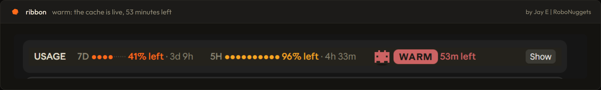
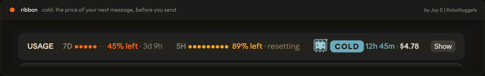
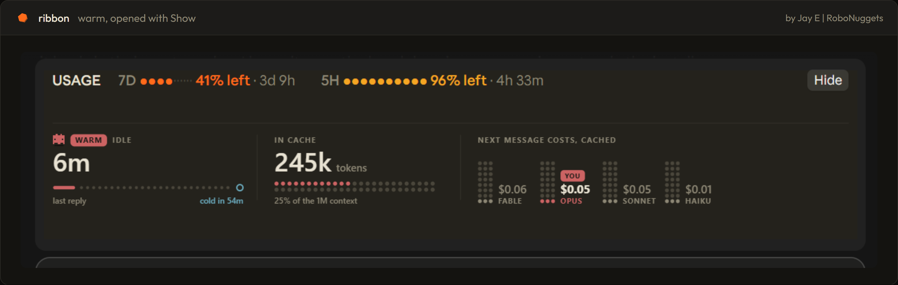
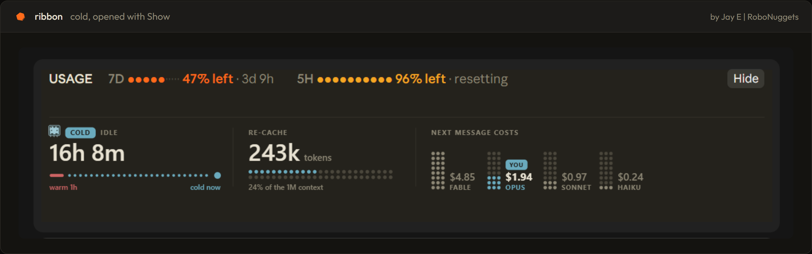

<p align="center">
  
</p>

# ribbon

A free mod for Claude Code. It adds a slim band above your prompt that shows:

- **How much usage you have left** in your 7-day and 5-hour windows, and when each one resets.
- **Whether your prompt cache is warm or cold**, and what your next message will cost.

It installs once and is there in every session after that. No commands to learn.

<p align="center">
  
</p>

<p align="center">
  
</p>

One row. That's the whole footprint.

## This fork

This is a fork of [robonuggets/ribbon](https://github.com/robonuggets/ribbon) 1.0.0, kept in claude-mods. It adds one thing:

- **A handoff before the cache goes cold.** When about 5 minutes of warm cache are left, the band sends the session one prompt asking it to use the `handoff` skill (`~/.claude/skills/handoff`). The handoff prompt is then waiting in the chat for you to paste into a new session. It's written while the cache is warm, so it costs the warm price, not the cold one.
  - It runs only in sessions with more than 20k tokens of context, and only once per idle stretch. Your next message turns it back on.
  - A toast says when it starts, and the band shows `handoff written` afterwards.
  - The handoff is itself a turn, so the cache stays warm for another hour after it.
  - The thresholds are `HANDOFF_LEAD_MS` and `HANDOFF_MIN_TOKENS` in `hooks/register.tsx`.

## Install

The fork installs from the claude-mods marketplace. The original and the fork are both named `ribbon`, so only one can be installed; remove the original first if you have it:

```
claude plugin uninstall ribbon@robonuggets
```

Add the marketplace if you haven't yet, then install the fork for your user:

```
claude plugin marketplace add D:\Projects\claude-mods
claude plugin install ribbon@claude-mods
```

Start a new session to see the band. The handoff also needs the `handoff` skill in `~/.claude/skills/handoff/`; without it, the session gets the prompt but has no skill to follow.

### Updating

Installed mods run from a copy in `~\.claude\plugins\cache\claude-mods\`. After a change here, bump `version` in `.claude-plugin/plugin.json`, then:

```
claude plugin marketplace update claude-mods
claude plugin update ribbon@claude-mods
```

The fork doesn't follow upstream. To take a later robonuggets/ribbon release, merge its changes into this folder by hand.

## What you see

### Usage left

- **7D** (orange) is your 7-day window. **5H** (yellow) is your 5-hour window.
- Each dot bar shows what is **left**, not what is used.
- Under each one is when it resets, for example `resets 3d 9h`.
- If a window drops under 15%, a bold **LOW** shows next to it.

### The prompt cache

After your first reply, the band also tracks the prompt cache. The cache keeps your chat cheap to continue for one hour after your last message.

- **WARM** (red, the robot bobs): the cache is live. It shows the minutes left and what your next message costs.
- **COLD** (blue, the robot is frozen): the hour has passed. Your next message re-sends the whole chat, so it costs more. It shows the price first.

Click **Show** to open the cache card, and **Hide** to fold it. Warm starts folded. Cold starts open, so you see the price before you send.

The card shows how long you've been idle, how many tokens are in the cache, and what the next message costs on each model. Your model is marked **YOU**. See [Up close](#up-close) below.

### Fits any width

- **Wide:** everything on one row.
- **Half width:** each window stacks into a small block.
- **Narrow:** the cache moves to its own row.
- **Terminal:** the same facts as plain text.

## Good to know

- **The band costs nothing to run.** It reads the app's own numbers and draws them. The one exception is the handoff, which is a normal turn at the warm price.
- **Prices are estimates.** They come from a price table in `hooks/cache-art.ts` (`MODELS`), not from your bill. If prices change, edit that table.
- **Subagents don't count.** Only your main chat resets the cache clock.

## What is inside

```
ribbon/
├── .claude-plugin/
│   └── plugin.json         the mod's name and version
├── hooks/
│   ├── hooks.json          points to the module
│   ├── register.tsx        the band: usage, cache tracking, layout
│   ├── cache-art.ts        the cache card and robot drawings, the price table
│   └── font.ts             Outfit, embedded so the drawings render anywhere
├── types/index.d.ts        the shape of what the band remembers
├── tests/                  11 tests: layouts, cache, handoff
├── LICENSE
└── assets/                 banner, screenshots, hex icon
```

## Remove it

```
claude plugin uninstall ribbon@claude-mods
```

## Develop it

From the claude-mods repo root, load the folder without installing it:

```
claude --plugin-dir plugins/ribbon
```

Check it and run the tests:

```
claude plugin validate plugins/ribbon
claude plugin test plugins/ribbon
```

## Up close

Click **Show** and the band opens into the cache card.

**Warm.** The cache is live. Your next message is cheap.

<p align="center">
  
</p>

**Cold.** The hour has passed. Your next message re-sends the whole chat, so it costs more.

<p align="center">
  
</p>

## License

[MIT](LICENSE).

The embedded font is [Outfit](https://github.com/Outfitio/Outfit-Fonts), under the SIL Open Font License 1.1.

Made by Jay E from RoboLabs. Learn more at [RoboNuggets](https://robonuggets.com).

<p align="center">
  
</p>
